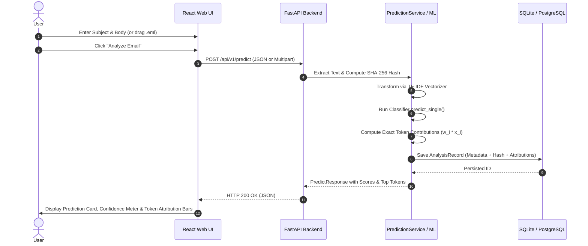
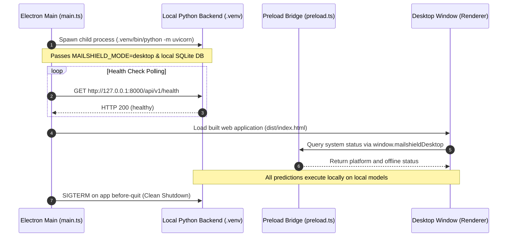

# MailShield — Monorepo Architecture & Sequence Workflows

## 1. Monorepo Organization

```text
MailShield/
├── apps/
│   ├── web/                    # React 18 + Vite + TypeScript + Tailwind CSS
│   │   ├── src/
│   │   │   ├── components/     # Header, Dashboard, Analyzer, History, ModelLab, Settings
│   │   │   ├── services/       # Typed API client
│   │   │   ├── types/          # Contract interfaces
│   │   │   └── App.tsx         # Tab router and root view
│   │   └── tests/              # Vitest + RTL component tests
│   └── desktop/                # Electron offline desktop runtime
│       └── src/
│           ├── main.ts         # Process supervision, backend lifecycle, window controls
│           └── preload.ts      # Secure contextBridge API
├── backend/
│   ├── app/
│   │   ├── api/v1/endpoints/   # predict, history, models, evaluation, auth, feedback, reports
│   │   ├── core/               # config, security, logging
│   │   ├── db/                 # SQLAlchemy engine, sessionmaker, base
│   │   ├── models/             # User, AnalysisRecord, EvaluationRun, UserFeedback
│   │   ├── schemas/            # Pydantic v2 schemas
│   │   ├── services/           # PredictionService, HistoryService, EvaluationService, AuthService
│   │   └── main.py             # FastAPI application and middleware
│   └── tests/                  # Pytest integration and contract tests
├── ml/
│   ├── artifacts/              # Serialized .joblib models and metadata.json
│   ├── data/                   # Seed corpus and dataset splits
│   ├── reports/                # Evaluation reports
│   ├── src/mailshield_ml/      # dataset, features, models, explainability, evaluation, pipeline
│   └── tests/                  # Pytest ML leakage, calibration, and math tests
├── docs/                       # 12 living engineering documentation files
├── scripts/                    # fetch_corpus.py, generate_seed_corpus.py
├── pyproject.toml              # Ruff and Pytest configuration
├── pytest.ini
└── README.md
```

---

## 2. Sequence Diagrams

### 2.1 Online Email Prediction & Feature Attribution



### 2.2 Dynamic Validation Threshold Simulation (Model Lab)

```mermaid
sequenceDiagram
    autonumber
    actor Analyst
    participant Web as Model Lab UI
    participant API as FastAPI Backend
    participant Eval as EvaluationService
    participant Cache as val_predictions_cache.json

    Analyst->>Web: Move Threshold Slider (&tau; = 0.35)
    Web->>API: GET /api/v1/models/threshold-metrics?model=logistic_regression&threshold=0.35
    API->>Eval: simulate_threshold("logistic_regression", 0.35)
    Eval->>Cache: Read genuine validation scores & ground truth labels
    Eval->>Eval: Compute TP, FP, TN, FN at &tau;
    Eval->>Eval: Compute Precision, Recall, F1, and False Positive Rate
    Eval-->>API: ThresholdSimulationResponse
    API-->>Web: HTTP 200 OK (JSON)
    Web->>Analyst: Update Confusion Matrix Heatmap & Performance Gauges in Real Time
```

### 2.3 Electron Desktop Offline Supervision


